# Measurement of Stimulated Raman Scattering (Matlab Code Implementation)

💥💥💥💞💞💞 Welcome to this blog❤️❤️❤️💥💥💥 
🏆 Bloggers' Advantage: 🌞🌞🌞 The content of the blog strives for rigorous thinking and clear logic, making it convenient for readers. 
⛳️ Mantra: A journey of a thousand miles is begun with a single step. 
Litchi Research Society
Code Collection: Power Systems, Intelligent Algorithms and Applications, Neural Network Prediction, Path Planning, Optimized Scheduling, Workshop Scheduling, Image Processing, Signal Processing... 
🎁 Special Section Links: 
🌈🌈🌈🌟🌟🌟🌟 Electrical Code Intelligent Algorithms and Their Applications Path Planning Neural Network Prediction Optimized Scheduling Image Processing Workshop Scheduling Signal Processing Romantic Her Thoughts My Philosophy Mathematical Model Complete Code Matters 
💥1 Overview 
Over the past two decades, the invention of optical frequency combs has enabled highly precise measurements of the energy values of multiple atoms and molecules transitions in the electromagnetic spectrum from 1-3. Accurate absolute frequency calibration plays a key role in one of the areas where fundamental physics is critically important, namely the spectroscopy of molecular hydrogen and its isotopes, whose transition frequencies can be theoretically predicted with precision4. The comparison between theory and experiment represents an experimental platform for quantum electrodynamics (QED) and serves as a powerful method to explore beyond the standard model6–8 or to determine fundamental quantities (such as the nuclear-to-electron mass ratio).
Frequency combs completely revolutionize optical frequency metrology, allowing for the determination of high-precision transition frequencies of a large number of molecules. Despite widespread recognition of scientific interest, these advances only marginally benefit from infrared inactive transitions due to their inherently weak cross sections. Here, we introduce stimulated Raman scattering metrology, whereby frequency mismatch between pumped and Stokes-excited lasers is calibrated using frequency combs. We apply this method to molecular hydrogen to test quantum electrodynamics. Our measurements of the Q(1) fundamental line of H show an uncertainty of just one billionth of a centimeter−1, equivalent to the theoretical benchmark from first principles, surpassing the experimental technology state by ten years. Our comb-based stimulated Raman scattering spectrometer expands the toolkit of optical frequency metrology because it can be applied simply through technical modifications to many other infrared inactive transitions spanning over 50-5000 cm−1.
📚2 Running Results
🎉3 References
🌈4 MATLAB Code Implementation

## Images

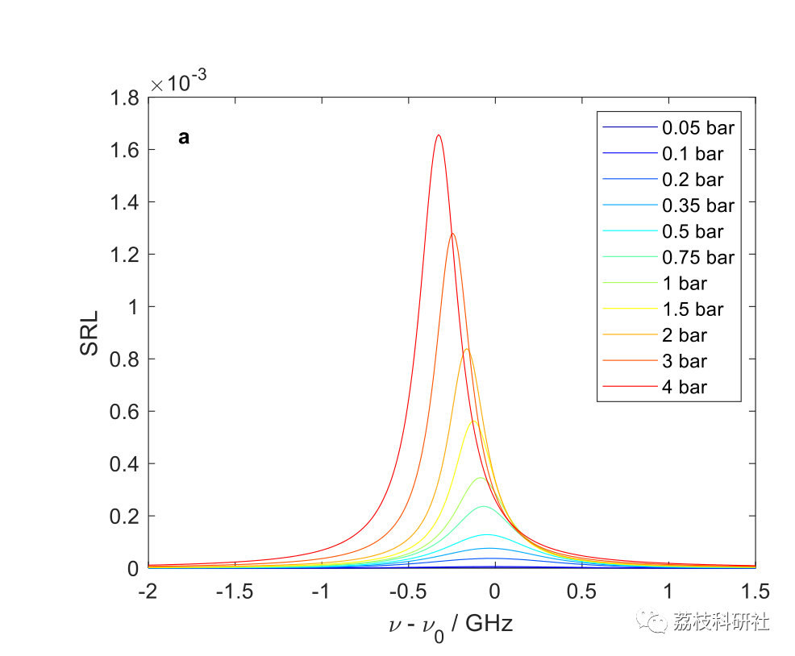
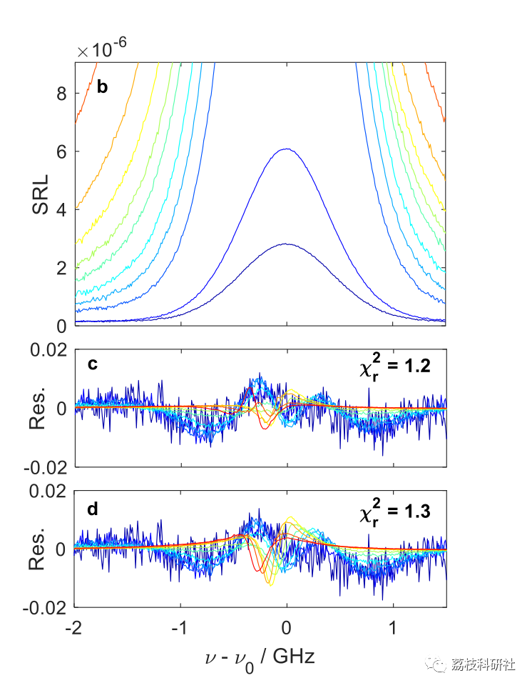
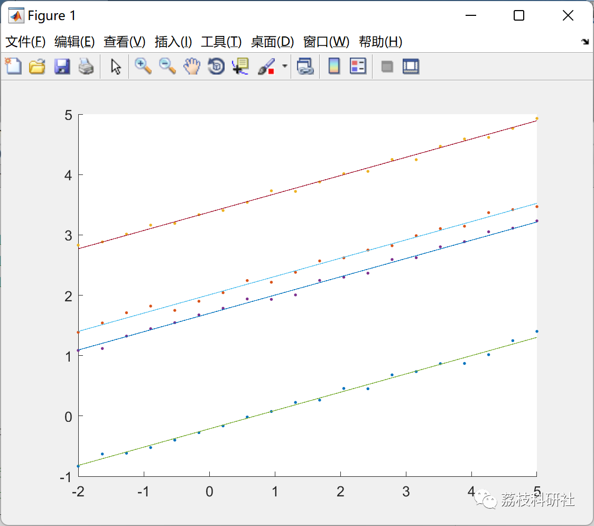
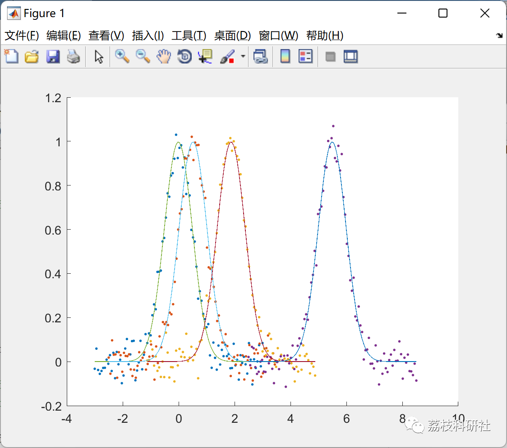
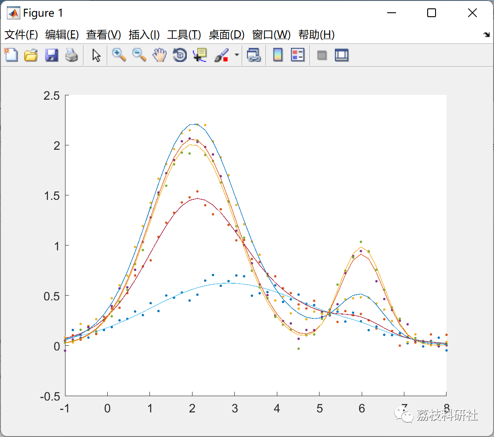
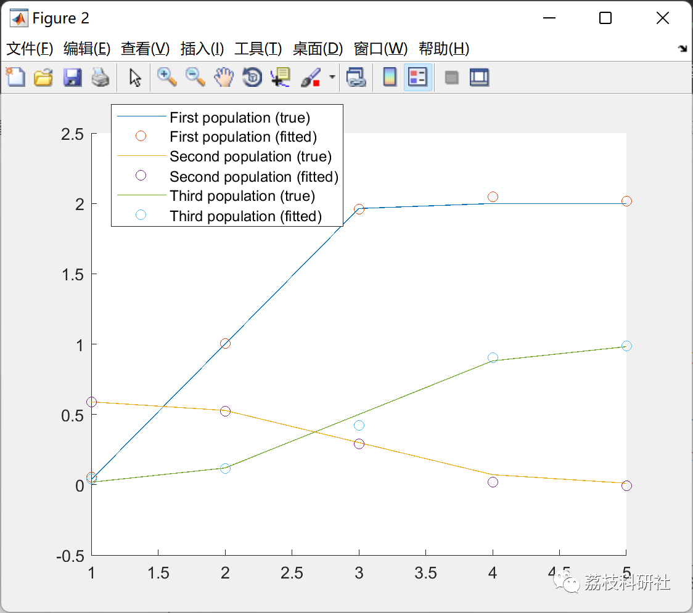
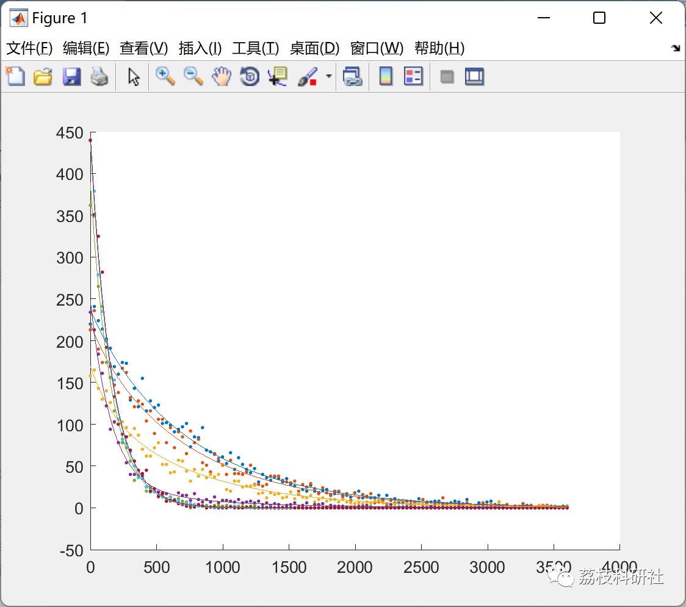
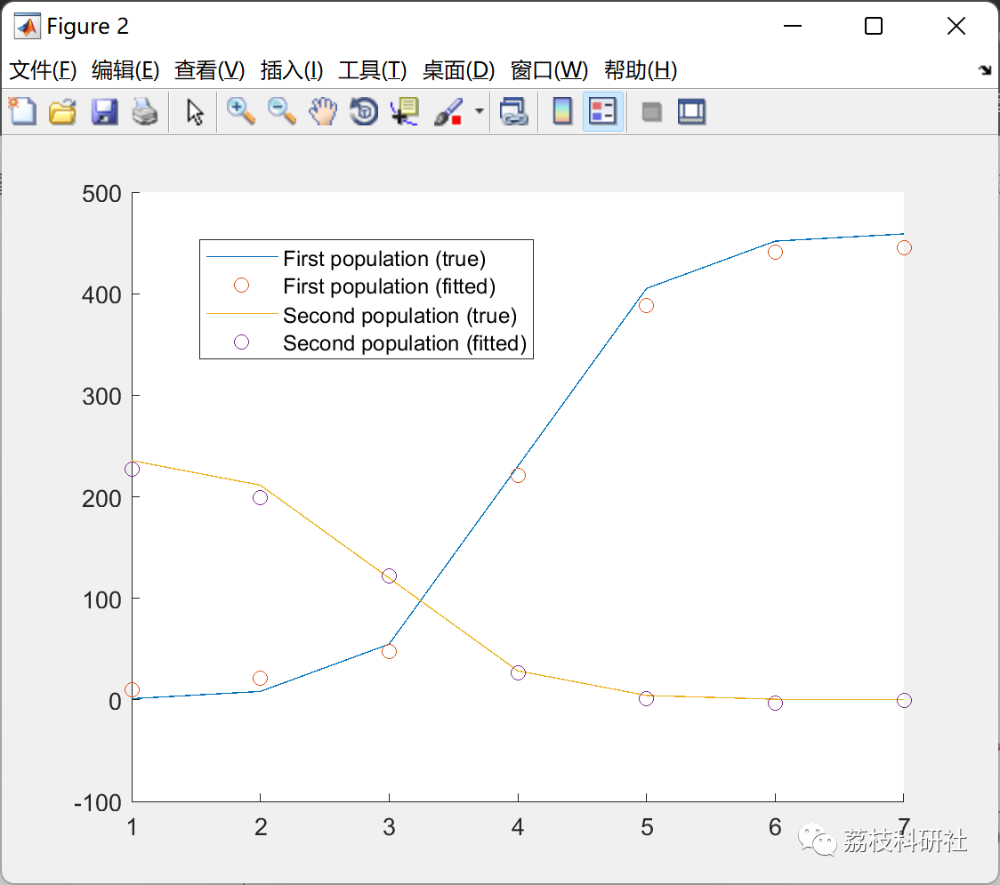
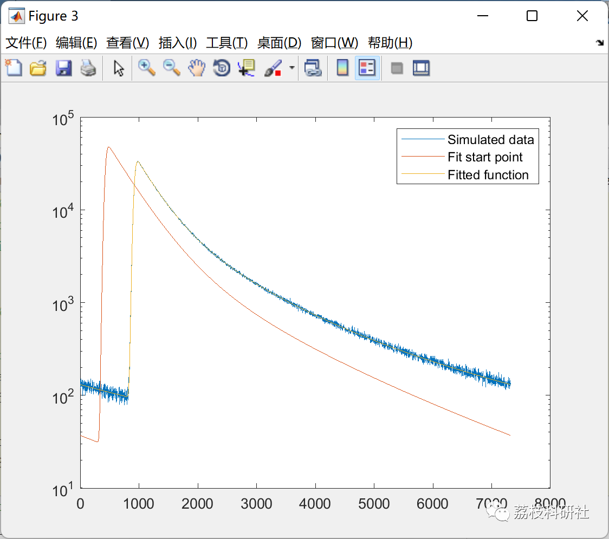
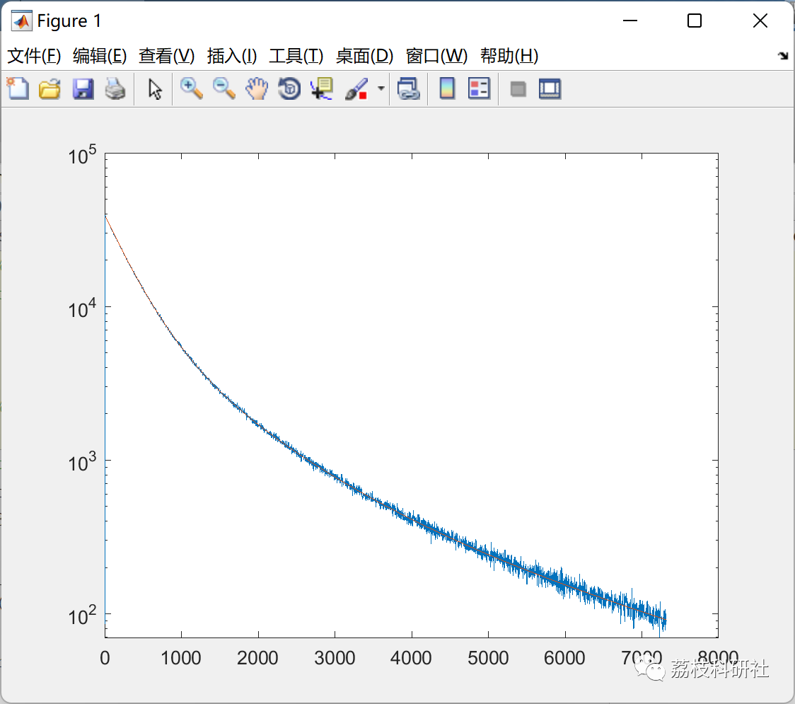
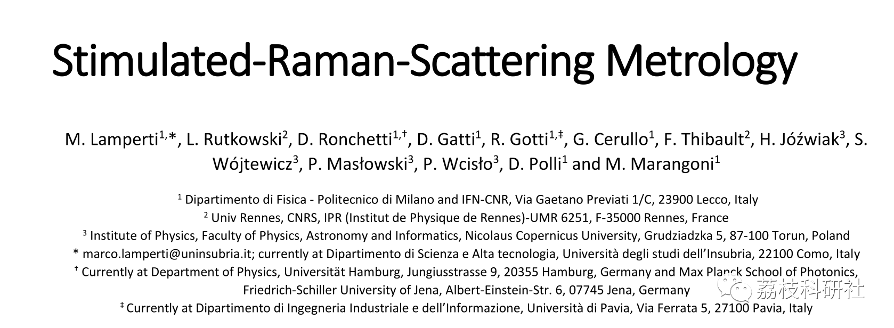

<!-- PAYMENT_BLOCK -->

## Get this dataset

- Payment link (Stripe): [Buy now](https://buy.stripe.com/3cs8yP7sY87d0vu9AB)
- Payment QR code: 

<!-- /PAYMENT_BLOCK -->
